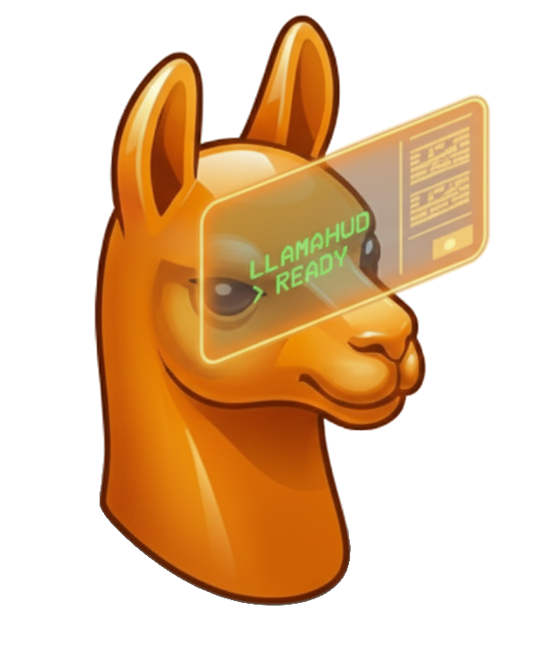

# LlamaHUD

**LlamaHUD** is a minimalist, keyboard-centric HUD for interacting with Local LLMs (Ollama) and cloud providers (OpenAI, Anthropic, etc.). It is designed to be unobtrusive, fast, and powerful.

## 🚀 Quick Start

1.  **Install**: Follow the [Installation Guide](docs/installation.md).
2.  **Run**: Execute `run_hud.bat`.
3.  **Chat**: Type your prompt and press Enter.

## 📚 Documentation

*   **[Installation](docs/installation.md)**: Setup instructions and requirements.
*   **[Basic Usage](docs/usage.md)**: How to interact with the HUD and notifications.
*   **[Commands](docs/commands.md)**: Master the `/`, `@`, and `#` prefixes.
*   **[Settings](docs/settings.md)**: Configure providers, models, and prompts.
*   **[Power Users](docs/power_users.md)**: Advanced shell command execution.

## ✨ Key Features

*   **Multi-Provider**: Support for Ollama, OpenAI, Anthropic, Google Gemini, and more.
*   **Interactive Notifications**: Reply to LLMs directly from Windows Toast notifications.
*   **Context Aware**: Drag-and-drop or use `@file` to chat with your documents.
*   **Prompt Chaining**: Save and reuse prompts with `/`.
*   **Native Feel**: Fast, lightweight, and integrates with your system tray.

## 🤝 Contributing

Contributions are welcome! Please feel free to submit a Pull Request.
